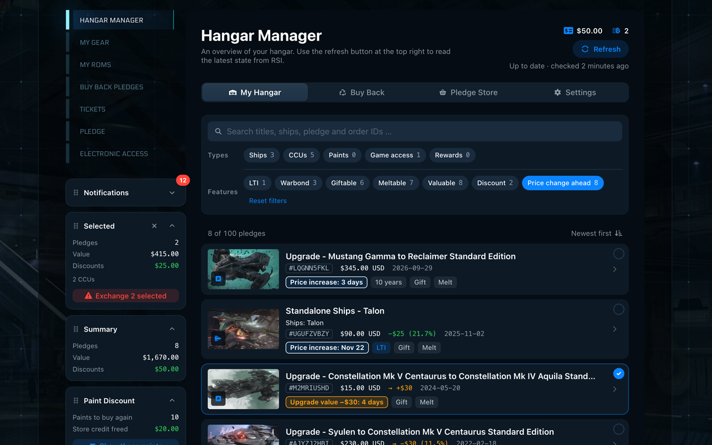

# Star Citizen Hangar Manager

Your whole Star Citizen hangar and buy back on one fast, searchable page – right on the RSI
website, in its look and feel. A free, open source browser extension for Chrome and Firefox. Your
data stays in your browser.

## Install

Submitted on 2026-11-05, currently in review:

- **Chrome:** "Star Citizen Hangar Manager" in the Chrome Web Store, ID
  `nofhjnkljndooegpllppamacogkikdjg`:
  <https://chromewebstore.google.com/detail/nofhjnkljndooegpllppamacogkikdjg> (available once the
  review is done)
- **Firefox:** "Star Citizen Hangar Manager" on Firefox Add-ons, add-on ID
  `star-citizen-hangar-manager@exrelax`:
  <https://addons.mozilla.org/firefox/addon/star-citizen-hangar-manager/> (available once the
  review is done)

Until then, you can install the extension from a file of the
[latest release on GitHub](https://github.com/exrelax/star-citizen-hangar-manager/releases/latest).
Installed this way, it doesn't update itself.

- **Chrome:** download `star-citizen-hangar-manager-1.0.0-chrome.zip` and unzip it into a
  folder. Open `chrome://extensions`, switch on **Developer mode** in the top right corner, click
  **Load unpacked** and select the folder.
- **Firefox:** download `star-citizen-hangar-manager-1.0.0-firefox.zip`. Open
  `about:debugging#/runtime/this-firefox`, click **Load Temporary Add-on…** and select the zip.
  Firefox removes the extension again when it is closed.

## What it does

- **Built for speed:** opens instantly from local data instead of RSI's 10 pledges per page,
  searches thousands of pledges as you type and checks for changes in the background – without
  ever blocking you
- **Private by design:** no account, no tracking, no server of its own – your hangar, buy back and
  orders are stored only in your browser
- Filters that include or exclude: ships, CCUs, paints, game access, rewards, LTI, warbond,
  giftable, meltable, valuable
- Melt values, discounts compared to the original price and the full CCU history of upgraded ships
- Orders with invoices, refund countdown and a prefilled refund request
- Buy back pledges with "probably giftable" hints, straight into the RSI cart
- Hide IDs, name, address and values for screenshots and streams, or show an anonymized selection
  in the demo mode
- Two themes ("Modern Hangar" and "Classic RSI") and four languages (English, German, French,
  Spanish)

RSI's own pages ("My Gear", "Buy Back Pledges") keep working as before. All features in detail:
[docs/FEATURES.md](docs/FEATURES.md).

## Getting started

1. Install the extension and log in on [robertsspaceindustries.com](https://robertsspaceindustries.com).
2. Open the Hangar Manager: with the new first entry **Hangar Manager** in the navigation of your
   RSI account, or with the extension's icon in the browser toolbar.
3. Click **Initial Load**. The manager reads your hangar, buy back and orders once – about 20
   seconds for 1,000 pledges, about 1.5 minutes for 5,000. From then on it opens instantly and
   keeps itself up to date.

In Firefox, the manager needs access to `robertsspaceindustries.com`. If the navigation entry
doesn't show up, allow it under `about:addons` → Star Citizen Hangar Manager → **Permissions**.

Exchanging (melting) and gifting pledges is sent to RSI only when you confirm it in the dialog.

## Privacy

The extension reads your hangar with your own RSI session and keeps it only in your browser. It
never sees your RSI login and has no server, no account and no tracking. For the ship links to
FleetYards.net and erkul.games it asks FleetYards.net about ship models – with nothing but their
names. Details: [privacy policy](PRIVACY.md).

## Help and feedback

- Found a bug or have an idea? Open an
  [issue](https://github.com/exrelax/star-citizen-hangar-manager/issues/new/choose). The version of
  your extension is in the manager's settings under **About**.
- What changed in each version: [CHANGELOG.md](CHANGELOG.md).

## Development

Built with [WXT](https://wxt.dev), Vue 3 and TypeScript. Setup, commands, dev mode, releasing and
the project structure: [docs/DEVELOPMENT.md](docs/DEVELOPMENT.md). Want to help? See
[CONTRIBUTING.md](CONTRIBUTING.md).

## License

[MIT](LICENSE) © exrelax. Provided "as is", without warranty: actions such as exchanging or
gifting pledges are sent to RSI only when you confirm them in the dialog, and you are responsible
for them.

Third-party parts keep their own licenses:

- Icons in `src/assets/svg-sprites/fa/`:
  [Font Awesome Free](https://fontawesome.com/license/free) (icons: CC BY 4.0); the notice is kept
  in the built sprite.
- The favicons of [erkul.games](https://www.erkul.games) and [FleetYards.net](https://fleetyards.net)
  belong to these sites; they are only used to label the links to them.

This is an unofficial fan project, not affiliated with or endorsed by Cloud Imperium Games or
Roberts Space Industries. Star Citizen® and Roberts Space Industries® are trademarks of Cloud
Imperium Rights LLC.
